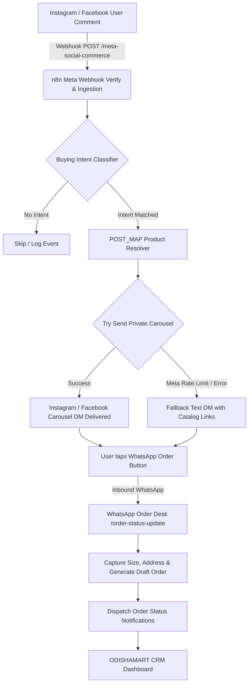

# 🏛️ ODISHAMART — D2C AutoDM Social Commerce Suite

> **Production-grade D2C Social Commerce Automation & Webhook CRM**  
> Architected for authentic Odisha handlooms & ethnic menswear — powered by local **n8n workflows**, **Meta Graph API**, and **WhatsApp Cloud API**.


---

## 👨‍💻 Developer Profile

| Attribute | Details |
| :--- | :--- |
| **Lead Architect & Developer** | **Gandhi Kalasi** |
| **Handle / Username** | **[@bug_gandhi](https://github.com/GANDHIKALASI)** |
| **Portfolio** | [https://portfolio-one-dun-f2390maeuj.vercel.app/](https://portfolio-one-dun-f2390maeuj.vercel.app/) |
| **GitHub** | [https://github.com/GANDHIKALASI](https://github.com/GANDHIKALASI) |
| **Specialization** | Enterprise Automation, Full-Stack Systems, n8n Orchestration, Meta Social Commerce |

---

## 🚀 Overview

**ODISHAMART** is an end-to-end social commerce automation platform engineered to turn Instagram & Facebook comments into paying customers, combined with a 24-hour conversational WhatsApp order management desk:

1. **Comment-to-DM Private Reply Carousel**: Detects buying intent keywords (e.g., `price`, `kitna`, `size`, `link`, `buy`) on social media posts and automatically dispatches a 10-card interactive private-reply carousel via Meta Graph API.
2. **Text-DM Fallback Engine**: If Meta rejects the carousel format, the system automatically falls back to a clean plain-text DM containing verified product catalog links.
3. **Conversational WhatsApp Order Desk**: Handles real-time customer messages, drafting and confirming orders with sizes, delivery addresses, and payment links.
4. **Interactive Local CRM Web App**: Single-file, zero-dependency production CRM dashboard with live webhook monitoring, order lifecycle management, catalog editor, and Developer Hub.

---

## 🏗️ Architecture Pipeline



---

## 📦 Repository Structure

```text
ODISHAMART/
├── odishamart-crm.html       # Consolidated Master Web Application & CRM Dashboard
├── index.html                # Symlink to odishamart-crm.html (instant root serve)
├── odishamart-n8n-crm.html   # Symlink to odishamart-crm.html (backward compatibility)
├── d2c-autodm-workflow.json  # Complete 12-node n8n local production workflow export
├── odishamart_logo.jpg       # Konark Sun Temple Wheel brand logo asset
├── .gitignore                # Git ignore rules for logs, env, and secrets
└── README.md                 # Complete system documentation & deployment guide
```

---

## 🛡️ Security & API Key Management

> [!IMPORTANT]
> **No live secrets or private tokens are stored in this repository.**
> All sensitive tokens (Meta Graph API tokens, WhatsApp Cloud API access keys, and webhook secrets) are decoupled from the code and managed securely via n8n's encrypted credential vault or environment variables.

### Environment & Token Decoupling:
- **`hub.verify_token`**: Handled via environment variables or n8n parameters (default mock: `replora_meta_verify`).
- **Meta Permanent Page Token**: Stored strictly inside n8n Credential Store as `whatsapp permanent token`.
- **Phone Number ID & Accounts**: Set dynamically in the Store Config node or the CRM settings panel.

---

## ⚡ Quick Start & Local Execution

### 1. Launch the CRM Web Application
You can serve the web CRM with any static web server:

```bash
# Using Python 3 built-in server
python3 -m http.server 3333
```
Open **[http://localhost:3333](http://localhost:3333)** in your browser.

### 2. Import & Start the n8n Workflow
1. Start your local n8n instance (Docker or npm):
   ```bash
   docker run -it --rm --name n8n -p 5678:5678 -v ~/.n8n:/home/node/.n8n n8nio/n8n
   ```
2. Open **`http://localhost:5678`**.
3. Click **Workflows > Import from File** and select [`d2c-autodm-workflow.json`](d2c-autodm-workflow.json).
4. Click **Activate Workflow**.

---

## 🧪 Webhook Testing & Verification

### 1. Meta Webhook Verification Handshake (GET)
```bash
curl -s "http://localhost:5678/webhook/meta-social-commerce?hub.mode=subscribe&hub.verify_token=replora_meta_verify&hub.challenge=ODISHAMART_TEST_2026"
# Output: ODISHAMART_TEST_2026
```

### 2. Simulate Inbound Instagram Comment (POST)
```bash
curl -s -X POST http://localhost:5678/webhook/meta-social-commerce \
  -H "Content-Type: application/json" \
  -d '{
    "entry": [{
      "changes": [{
        "field": "comments",
        "value": {
          "id": "cm_test_101",
          "from": { "id": "user_101", "username": "priya_handlooms" },
          "message": "Price for Sambalpuri Ikat Kurta please?",
          "post_id": "post_101",
          "created_time": 1729367400
        }
      }]
    }]
  }'
# Output: {"message":"Workflow was started"}
```

### 3. Trigger WhatsApp Order Status Update (POST)
```bash
curl -s -X POST http://localhost:5678/webhook/order-status-update \
  -H "Content-Type: application/json" \
  -d '{
    "order_id": "ORD-10452",
    "status": "shipped",
    "tracking_number": "ODISHA-EXP-8899",
    "carrier": "DTDC Express Odisha",
    "customer": {
      "name": "Priyabrata Mohapatra",
      "phone": "+919876543210"
    }
  }'
# Output: {"message":"Workflow was started"}
```

---

## 🌐 How to Publish

### Option A: Publish CRM Frontend to GitHub Pages (Recommended - Free)
1. In your GitHub repository: **Settings > Pages**.
2. Under **Build and deployment**:
   - **Source**: `Deploy from a branch`
   - **Branch**: `main` / `/ (root)`
3. Click **Save**.
4. In ~60 seconds, your CRM will be live at:
   `https://gandhikalasi.github.io/ODISHAMART/`

### Option B: Deploy Frontend to Vercel
```bash
npm i -g vercel
vercel deploy --prod
```
Since [`index.html`](index.html) is already at the root, Vercel will immediately deploy the full dashboard with zero build configuration.

### Option C: Production n8n Deployment
For live production Meta webhooks:
1. Deploy n8n on a VPS (AWS, DigitalOcean, Hetzner, or n8n Cloud) with SSL (`https://`).
2. In **Meta Developer Portal > Webhooks**:
   - Callback URL: `https://your-n8n-domain.com/webhook/meta-social-commerce`
   - Verify Token: Matches your `verify_token` in n8n.
3. Subscribe to `Instagram > comments` and `Page > feed`.

---

## 📄 License & Attribution

Designed and developed with ❤️ by **Gandhi Kalasi** ([@bug_gandhi](https://github.com/GANDHIKALASI)).  
Released under the **MIT License**.
