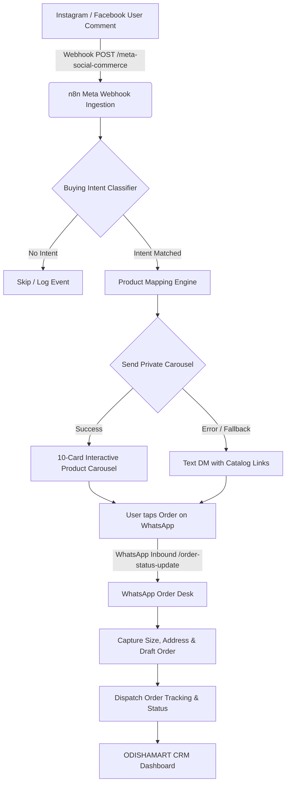
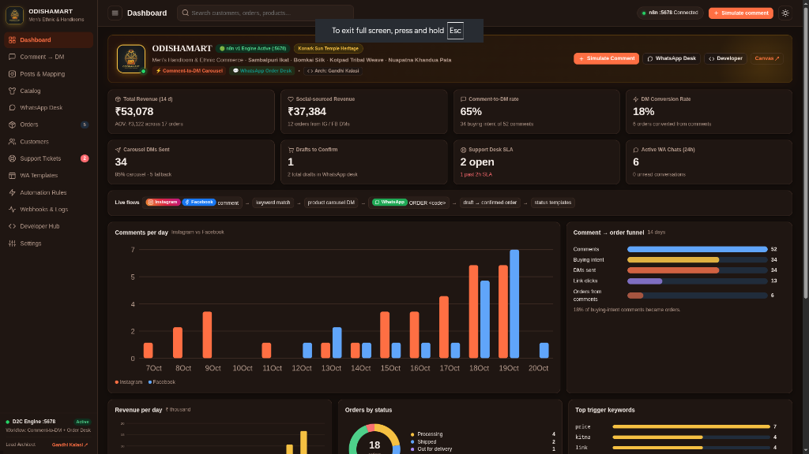

# 🏛️ ODISHAMART — D2C AutoDM Social Commerce Suite

> **Production-grade Social Commerce Automation & Webhook CRM**  
> Architected for authentic Odisha handlooms & menswear — powered by **n8n workflows**, **Meta Graph API**, and **WhatsApp Cloud API**.

<p align="center">
  
</p>

---

## 🚀 Overview

**ODISHAMART** is an automated social commerce pipeline engineered to turn Instagram and Facebook engagement into direct sales with automated WhatsApp fulfillment:

1. **Comment-to-DM Private Carousel**: Automatically detects buying intent keywords (`price`, `buy`, `size`, `link`, etc.) on posts and replies privately with a 10-card interactive product carousel.
2. **Text-DM Fallback Engine**: If Meta rejects the carousel or limits media, the engine immediately dispatches a formatted text fallback with direct product checkout links.
3. **Conversational WhatsApp Order Desk**: 24/7 automated assistant for live order tracking, draft creation, size/address capture, and customer support.
4. **Unified Operations Dashboard**: Single-file, responsive CRM for managing orders, reviewing webhook traces, editing handloom catalogs, and simulating live customer events.

---

## 🏗️ Architecture Pipeline



---

## 📸 Dashboard Visuals

The CRM dashboard provides real-time visibility into conversion funnels, revenue breakdown, comments, orders, and webhook logs:



---

## 📦 Repository Structure

```text
ODISHAMART/
├── odishamart-crm.html       # Consolidated Master CRM Application & Webhook Monitor
├── index.html                # Symlink to odishamart-crm.html (instant root serve)
├── odishamart-n8n-crm.html   # Symlink to odishamart-crm.html
├── d2c-autodm-workflow.json  # Complete 12-node production n8n workflow export
├── odishamart_dashboard.png  # CRM Dashboard interface screenshot
├── odishamart_logo.jpg       # Brand logo (Konark Sun Temple wheel)
├── .gitignore                # Git ignore rules for logs, env, and secrets
└── README.md                 # Project documentation & deployment guide
```

---

## ⚡ Quick Start & Local Execution

### 1. Run the CRM Dashboard
```bash
# Start a local static server
python3 -m http.server 3333
```
Open **[http://localhost:3333](http://localhost:3333)** in your browser.

### 2. Import Workflow into Local n8n
1. Start n8n locally:
   ```bash
   docker run -it --rm --name n8n -p 5678:5678 -v ~/.n8n:/home/node/.n8n n8nio/n8n
   ```
2. Open **`http://localhost:5678`**.
3. Go to **Workflows > Import from File** and select [`d2c-autodm-workflow.json`](d2c-autodm-workflow.json).
4. Click **Activate**.

---

## 🧪 Webhook Testing & Verification

### 1. Meta Webhook Verification Handshake (GET)
```bash
curl -s "http://localhost:5678/webhook/meta-social-commerce?hub.mode=subscribe&hub.verify_token=replora_meta_verify&hub.challenge=ODISHAMART_TEST_CHALLENGE"
# Expected output: ODISHAMART_TEST_CHALLENGE
```

### 2. Simulate Inbound Instagram Comment (POST)
```bash
curl -s -X POST http://localhost:5678/webhook/meta-social-commerce \
  -H "Content-Type: application/json" \
  -d '{
    "entry": [{
      "changes": [{
        "field": "comments",
        "value": {
          "id": "cm_test_101",
          "from": { "id": "user_101", "username": "priya_handlooms" },
          "message": "Price for Sambalpuri Ikat Kurta please?",
          "post_id": "post_101",
          "created_time": 1729367400
        }
      }]
    }]
  }'
# Expected output: {"message":"Workflow was started"}
```

### 3. Trigger WhatsApp Order Status Update (POST)
```bash
curl -s -X POST http://localhost:5678/webhook/order-status-update \
  -H "Content-Type: application/json" \
  -d '{
    "order_id": "ORD-10452",
    "status": "shipped",
    "tracking_number": "ODISHA-EXP-8899",
    "carrier": "DTDC Express Odisha",
    "customer": {
      "name": "Priyabrata Mohapatra",
      "phone": "+919876543210"
    }
  }'
# Expected output: {"message":"Workflow was started"}
```

---

## 🌐 How to Publish

### 1. Host Dashboard on GitHub Pages (Instant & Free)
1. In your GitHub repository: navigate to **Settings > Pages**.
2. Under **Build and deployment > Branch**, choose:
   - Branch: **`main`**
   - Folder: **`/ (root)`**
3. Click **Save**.
4. In ~60 seconds, your CRM will be live at:
   > **`https://gandhikalasi.github.io/ODISHAMART/`**

### 2. Deploy Dashboard on Vercel
```bash
npx vercel
```
Or connect this GitHub repository in your [Vercel Dashboard](https://vercel.com/new).

### 3. Connect Meta Webhooks in Production
1. Host n8n on any VPS or cloud provider with HTTPS (e.g., `https://automation.yourdomain.com`).
2. In the **Meta for Developers** console under **Webhooks**:
   - Set Callback URL to: `https://automation.yourdomain.com/webhook/meta-social-commerce`
   - Enter your `verify_token`.
3. Subscribe to `Instagram > comments` and `Page > feed`.

---

## 🛡️ Security & API Key Notice

> [!NOTE]
> All sensitive tokens and credentials (Meta Graph API keys, WhatsApp Cloud API tokens) are managed securely via n8n's encrypted credential manager and environment variables. No private secrets are committed to this repository.

---

## 👨‍💻 Developer

**Gandhi Kalasi**  
- **GitHub:** [@bug_gandhi](https://github.com/GANDHIKALASI)  
- **Portfolio:** [portfolio-one-dun-f2390maeuj.vercel.app](https://portfolio-one-dun-f2390maeuj.vercel.app/)  
- **Role:** Full-Stack Developer & Enterprise Automation Architect

---

## 📄 License

This project is licensed under the **MIT License**.
